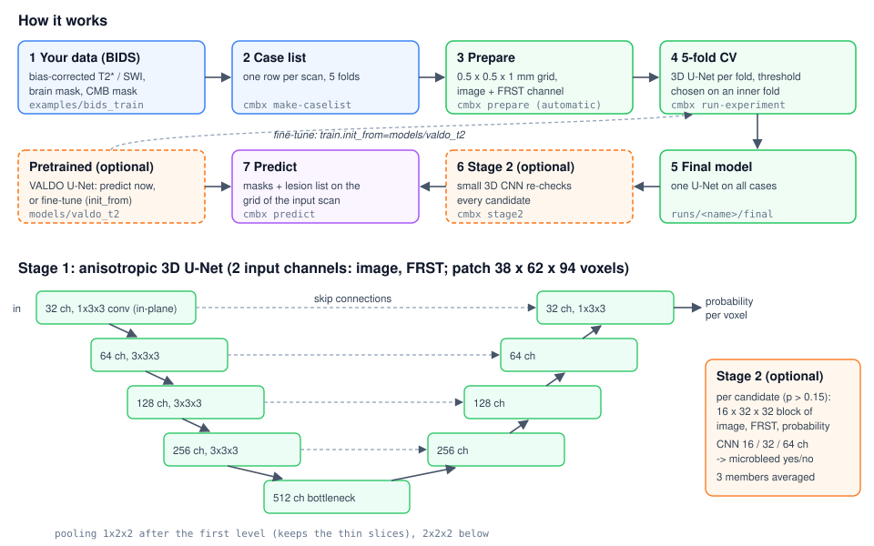
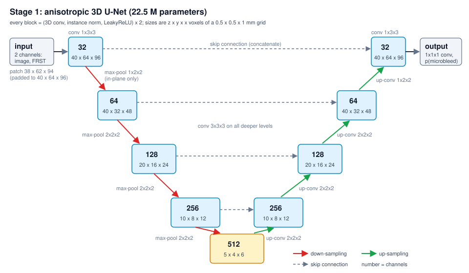

# cmb_3d_unet_experiments
> Find cerebral microbleeds on T2* and SWI MRI with a 3D U-Net.

Predict with a pretrained model, fine-tune it, or train on your own data. Python package `cmbx`.





## Installing / Getting started

```bash
git clone https://github.com/mendeltem/cmb_3d_unet_experiments.git
```

```bash
cd cmb_3d_unet_experiments
```

```bash
./install.sh
```

- Installs Python, PyTorch for your GPU, `cmbx` and the pretrained model `models/valdo_t2`.
- Ends with `ALL REQUIRED CHECKS PASSED`.

```bash
source env.sh
```

- Activates the environment. Run it again in every new shell.

## Predict with the pretrained model

```bash
cmbx predict --run models/valdo_t2 --image examples/bids_new/derivatives/biascorr/sub-001/anat/sub-001_T2starw_desc-biascorr_T2starw.nii.gz --brain-mask examples/bids_new/derivatives/brainmask/sub-001/anat/sub-001_T2starw_desc-brain_mask.nii.gz --out ../my_runs/pred
```

- Writes the microbleed mask, a labelled lesion map, `sub-001_T2starw_desc-biascorr_T2starw.json` (one entry per
  microbleed) and `predictions.csv` to `../my_runs/pred`.
- Your scan: replace `--image` (bias-corrected T2*) and `--brain-mask`.

## Train on your data

Data layout (as in `examples/bids_train`):

```
my_dataset/
├── participants.tsv
└── derivatives/
    ├── biascorr/sub-001/anat/sub-001_T2starw_desc-biascorr_T2starw.nii.gz
    ├── brainmask/sub-001/anat/sub-001_T2starw_desc-brain_mask.nii.gz
    └── manual-cmb/sub-001/anat/sub-001_T2starw_desc-cmb_mask.nii.gz
```

```bash
DATA=/path/to/my_dataset
```

```bash
RUNS=../my_runs
```

```bash
cmbx make-caselist --bids $DATA --out $RUNS/cases.csv
```

- Writes the case list with 5 folds and reports missing files or suspicious masks.

```bash
cmbx run-experiment configs/baseline.yaml --set name=my_run output_root=$RUNS/runs data.cases=$RUNS/cases.csv data.prepared_dir=$RUNS/prepared data.splits=$RUNS/splits.json
```

- Trains and tests 5 models (cross-validation), then one final model on all cases (about 3 h on one GPU).
- Score: `$RUNS/runs/my_run/summary.json`. Model: `$RUNS/runs/my_run/final/model.pt`.

Fine-tune the pretrained model instead (minutes, usually better):

```bash
cmbx run-experiment configs/baseline.yaml --set name=my_finetune output_root=$RUNS/runs data.cases=$RUNS/cases.csv data.prepared_dir=$RUNS/prepared data.splits=$RUNS/splits.json train.init_from=models/valdo_t2 train.lr=0.0001
```

Optional second stage, a 3D classifier that re-checks every candidate:

```bash
cmbx stage2 $RUNS/runs/my_run
```

- Trained on the run's cross-validation output; `predict` uses it automatically from then on.

## Predict with your model

```bash
cmbx predict --run $RUNS/runs/my_run --image /path/to/scan.nii.gz --brain-mask /path/to/brainmask.nii.gz --out $RUNS/pred
```

## SLURM

```bash
mkdir -p logs
```

```bash
sbatch scripts/slurm_run_experiment.sbatch configs/baseline.yaml name=my_run output_root=$RUNS/runs data.cases=$RUNS/cases.csv data.prepared_dir=$RUNS/prepared data.splits=$RUNS/splits.json
```

- Same as `run-experiment` above, as a job on a GPU share; output in `logs/`.

## Features

- 5-fold cross-validation with honest scores and a final model.
- Pretrained VALDO model for direct use or fine-tuning.
- Optional second-stage 3D classifier.
- Masks and lesion lists on the grid of the input scan.
- Experiments by config: input channels, losses, inpainting, CSF rule.

## Configuration

Add any of these to `--set` (all options: [docs/DETAILS.md](docs/DETAILS.md)):

| key | default | |
|---|---|---|
| `train.epochs` | `60` | training length |
| `train.init_from` | none | start from a trained model, e.g. `models/valdo_t2` |
| `train.lr` | `0.0003` | learning rate; `0.0001` for fine-tuning |
| `stage2.enabled` | `false` | train the second stage inside `run-experiment` |
| `train.device` | `auto` | `cuda`, `cpu` |

## Links

- Details, results, validation: [docs/DETAILS.md](docs/DETAILS.md)
- Issues: https://github.com/mendeltem/cmb_3d_unet_experiments/issues
- Pretrained weights: https://github.com/mendeltem/microbleed_detection_3D_UNET/releases/tag/v0.1.0

## Licensing

- Code: MIT. Pretrained VALDO weights: CC BY-NC-SA 4.0 (non-commercial).
- Cite VALDO: Sudre et al., Med Image Anal 2024, doi:10.1016/j.media.2023.103029.
- Patient data never go into this repository; keep data and outputs outside it.

## Hardware

- GPU: NVIDIA or AMD with 2 GB memory or more; a CPU works, but training is slow.
- RAM: 32 GB for training.
- Only the GPU driver is needed, no CUDA toolkit.
- Time on one GPU: training about 3 h, fine-tuning minutes, prediction seconds per scan.
