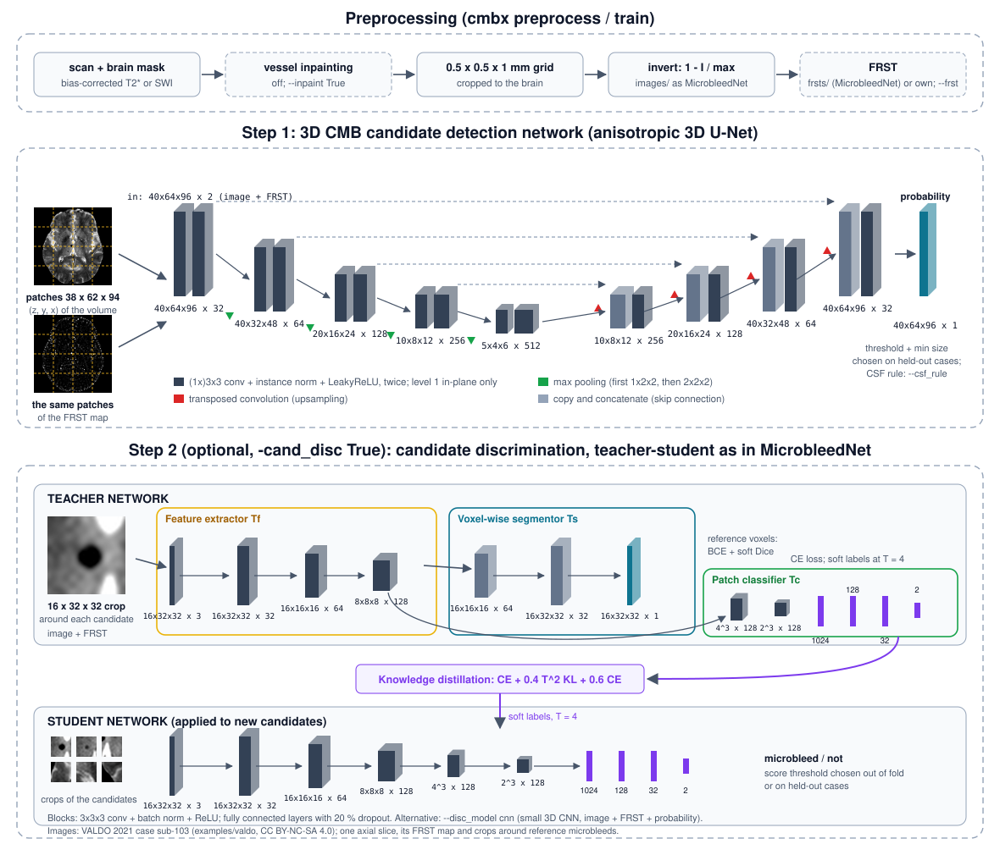

# cmb_3d_unet_experiments
> Find cerebral microbleeds on T2* and SWI MRI with a 3D U-Net. Same commands and folders as MicrobleedNet.



- Step 1: a 3D U-Net marks microbleed candidates (input: image + FRST).
- Step 2 (optional): a classifier re-checks every candidate; the teacher–student network of MicrobleedNet or a small CNN.
- Scripts written for [MicrobleedNet](https://github.com/v-sundaresan/microbleed-detection) run with `cmbx` in place of
  `microbleednet`. Differences: [below](#differences-to-microbleednet).

## Install

```bash
git clone https://github.com/mendeltem/cmb_3d_unet_experiments.git
```

```bash
cd cmb_3d_unet_experiments
```

```bash
./install.sh
```

```bash
source env.sh
```

- Installs Python, PyTorch for your GPU, `cmbx` and the pretrained model. Ends with `ALL REQUIRED CHECKS PASSED`.
- `source env.sh` in every new shell.

## Data

```
my_cohort/
├── files.xlsx                              list of all files
└── derivatives/
    ├── preprocessed/sub-001/
    │   ├── sub-001_t2star.nii.gz           bias-corrected T2* (SWI: sub-001_swi.nii.gz)
    │   ├── sub-001_brainmask.nii.gz        brain mask
    │   ├── sub-001_cmb.nii.gz              microbleed mask (training only)
    │   ├── sub-001_synthseg.nii.gz         optional: SynthSeg, for --csf_rule True
    │   └── sub-001_flair.nii.gz            optional: FLAIR on the T2* matrix, for --flair True
    ├── images/sub-001_preproc.nii.gz       MicrobleedNet input (inverted T2*)
    ├── frsts/sub-001_frst.nii.gz           MicrobleedNet FRST
    ├── images_inpainted/                   optional: the same with vessel inpainting, for --inpaint True
    └── frsts_inpainted/
```

- Examples: `examples/train` (10 synthetic cases), `examples/new` (2, no labels), `examples/raw` (scans before preprocessing).
- `images/` and `frsts/` are MicrobleedNet's own folder names: both methods read the same inputs.

## Preprocess

```bash
cmbx preprocess -i examples/raw -ir _T2starw -f True -b examples/raw -br _brainmask.nii.gz -l examples/raw -lr _cmb.nii.gz -flr _FLAIR -o ../my_runs/cohort/derivatives/preprocessed
```

- Writes one folder per case and `../my_runs/cohort/files.xlsx`.
- Without `-f True`: skull stripping and bias correction with FSL (BET + FAST), as MicrobleedNet.
- FLAIR (`-flr`, same session): BET, FAST (FSL, also with `-f True`), then onto the T2* by the scanner coordinates
  (`--flair_registered True` if it is already: no FSL).
- `--synthseg True` adds the tissue map (FreeSurfer; from the FLAIR when there is one). `-mod swi` names the scan `_swi`.
- `--microbleednet_inputs True` adds `images/` + `frsts/` with MicrobleedNet's own code (installed separately),
  `--inpaint True` also `images_inpainted/` + `frsts_inpainted/`. Without them, `cmbx train -i ../my_runs/cohort`
  computes the FRST itself.

## Train

```bash
cmbx train -i examples/train/derivatives -l examples/train/derivatives/preprocessed -m ../my_runs/my_model
```

- As MicrobleedNet: `-i` holds `images/` and `frsts/`, `-l` the microbleed masks; image and FRST go into the network.
- One model -> `../my_runs/my_model/final/model.pt`; 20 % of the cases choose the threshold (`-tr_prop 0.8`).
- About 25 min on one GPU for 60 cases.

Switch steps on or off, e.g. without FRST:

```bash
cmbx train -i examples/train/derivatives -l examples/train/derivatives/preprocessed -m ../my_runs/no_frst --frst False
```

| option | default | |
|---|---|---|
| `--frst` | `True` | FRST as second input channel |
| `--inpaint` | `False` | use `images_inpainted/` + `frsts_inpainted/` (MicrobleedNet's vessel inpainting) |
| `--frst_from` | `microbleednet` | FRST from `frsts/`, or `cmbx` (computed on the 0.5 mm grid) |
| `--csf_rule` | `False` | drop detections in CSF (needs `_synthseg`) |
| `--flair` | `False` | FLAIR as extra input channel (needs `_flair`) |
| `-cand_disc` | `False` | train step 2, MicrobleedNet's teacher–student (`--disc_model cnn`: small CNN) |
| `-ep`, `-ilr`, `-bs` | `60`, `0.0003`, `4` | epochs, learning rate, batch size |

Every MicrobleedNet option works (`-tr_prop`, `-es`, `-cp_type`, `-lrm`, `-opt`, ...): `cmbx train --help`,
[docs/DETAILS.md](docs/DETAILS.md#microbleednet-options). `tests/test_microbleednet_parity.py` checks all 96 options of
MicrobleedNet's five commands (commit 958f1cb): each is accepted, reaches the config or is reported as without effect, and
`--defaults microbleednet` gives MicrobleedNet's own defaults; one run sets every option at once. One intended difference:
switches read `False` as False (MicrobleedNet's `type=bool` turns any text, even "False", into True).

Without the switch the options you leave out keep cmbx's own recipe. To start from MicrobleedNet's own values
instead, add `--defaults microbleednet` (also on `fine_tune` and `cross_validate`): every MicrobleedNet option you did
not type on the command line then takes the value MicrobleedNet uses (`-tr_prop 0.8`, `-bfactor 10`, `-psize 48`,
`-af 2`, `-da True`, `-cand_disc True`, `-lrm 10`, `-gamma 0.1`, `-opt adam`, `-eps 1e-4`, `-mom 0.9`, `-es 20`,
`-cp_type last`, `-cp_n 10`, `-bs 4`, `-ep 100`, `-ilr 0.001`; for `fine_tune` `-bs 8`, `-ep 60`, `-ilr 0.0001`,
for `cross_validate` `-bs 8`, `-ep 60`, `-ilr 0.001`). Options you type still win, so
`cmbx train ... --defaults microbleednet -ep 60` runs MicrobleedNet's settings for 60 epochs. `--defaults cmbx` (the
default) changes nothing. `-ftlayers` is not filled: its numbers refer to MicrobleedNet's own decoder blocks ("1 2 -> final two decoder
layers"), not to the cmbx levels (1 = output ... 9 = input), so set it yourself if needed. A key you set with `--set`
(e.g. `--set train.lr=0.0003`) is not overridden by the preset.

## Fine-tune the pretrained model

```bash
cmbx fine_tune -i examples/train/derivatives -l examples/train/derivatives/preprocessed -m pre -o ../my_runs/my_finetuned
```

- `-m pre`: the pretrained VALDO model (trained with the cmbx FRST, which it keeps); or any model folder. Learning rate 0.0001.

## Predict

```bash
cmbx evaluate -i examples/new/derivatives -m ../my_runs/my_model -o ../my_runs/pred
```

- Masks on the input grid: `../my_runs/pred/final_predictions/predicted_final_cmbx_<case>.nii.gz`.
- One entry per microbleed: `../my_runs/pred/details/<case>.json`. `-int True` adds the step-1 maps.

## Cross-validation

```bash
cmbx cross_validate -i examples/train/derivatives -l examples/train/derivatives/preprocessed -o ../my_runs/cv -fold 5
```

- Lesion-level F1 out of fold: `../my_runs/cv/summary.json`. Same folds for every setting you compare.
- Five trainings of 60 epochs: about 1 h on one GPU even for the examples; `-ep 2` for a quick try.

## The easiest way: four short Python scripts

`examples/easy/` trains, tests and fine-tunes in a few lines each, with `cmbx.easy` (see `examples/easy/README.md`):

```bash
python examples/easy/1_prepare_data.py     # the five VALDO example scans -> train (3) and test (2)
python examples/easy/2_train.py            # train a model from scratch
python examples/easy/3_test.py             # test the pretrained model (or: 3_test.py <model folder>)
python examples/easy/4_fine_tune.py        # fine-tune the pretrained model and test it
python examples/easy/run_all.py            # or all four in one go
```

## Test every experiment on example data

`examples/valdo` holds five real VALDO 2021 T2* scans (four with microbleeds, one without; CC BY-NC-SA 4.0, see
`examples/valdo/README.md`). `test_all_cases.py` runs every experiment of this repository on them with the same `cmbx`
commands: the pretrained model as downloaded, training from scratch with and without FRST, the CSF rule, fine-tuning,
the step-2 classifier (teacher-student and small CNN), vessel inpainting (only if `microbleednet` is installed) and a
3-fold cross-validation. Afterwards it writes a report (PNG images + CSV) with TP, FP, FN, sensitivity, precision and lesion F1.

```bash
./install.sh && source env.sh                   # once; in every new shell: source env.sh (never the system Python)
python test_all_cases.py --list                 # the experiments
python test_all_cases.py                        # all of them (GPU), results in ../my_runs/test_all_cases
python test_all_cases.py --device cpu --epochs 2 --only pretrained finetune
```

Report: `<out>/report/summary_1.png` (table) and `summary_2.png` (F1 chart), `<out>/report/<case>_N.png` (per test case) and
`<out>/report/results.csv`. With 4 epochs on 3 training cases the numbers show that every path runs, not how good a
model is. The two step-2 experiments start from the fine-tuned pretrained model: a 4-epoch model trained from scratch
finds no candidates, so step 2 would have nothing to learn from. Started from a Python without `cmbx`, `torch`,
`nibabel` or `matplotlib` (e.g. the conda base environment), the script stops at once and says which environment to
activate.

## Testing: three levels

| Command | What it checks | Time (GPU / CPU) |
|---|---|---|
| `python test.py` | every function works (environment, networks, 5-fold CV on 10 synthetic phantoms) | 1 min / 1 min |
| `python examples/easy/run_all.py` | the four short scripts: prepare, train, test, fine-tune on the VALDO examples | ~5 min / ~30 min |
| `python test_all_cases.py` | every experiment of the repository on the VALDO examples, with a report | ~10 min / ~2 h |

Expected results (4 epochs; 2 test cases with 6 microbleeds in total, checked on an A100 shard and on a CPU):

| Experiment | found | false alarms | F1 |
|---|---|---|---|
| pretrained / + CSF rule | 5 of 6 | 1 | 0.83 |
| finetune / + CSF rule | 6 of 6 | 1 | 0.92 |
| step 2 teacher-student | 6 of 6 | about 12 | about 0.5 |
| step 2 CNN | 5 of 6 | about 2 | about 0.8 |
| scratch (3 variants) | 0-2 of 6 | hundreds to thousands | 0.00 (4 epochs are far too few -- expected) |
| inpaint | skipped without `microbleednet` | | |
| cross_validate | ok | | |

On a SLURM cluster (GPU shard; activate the environment inside the job):

```bash
sbatch -p gpu --gres=shard:1 --cpus-per-task=8 --mem=32G --time=02:00:00 -o test_all_cases_%j.log \
  --wrap "source ./env.sh && python test_all_cases.py"
```

`./env.sh` is written by `./install.sh` (sh does not search the current folder, hence the `./`). Without it, activate
the environment by name: `--wrap "source <conda>/etc/profile.d/conda.sh && conda activate cmbx && python test_all_cases.py"`.

## From Python

The same steps as plain Python scripts, written out one by one so that you can read and change each: the cases onto the
model grid, patches, loss, optimizer, the threshold chosen on held-out cases, the masks back on the scan.

```bash
python examples/python/01_train_unet.py -i examples/train/derivatives/preprocessed -m ../my_runs/py_model --epochs 5
```

```bash
python examples/python/02_predict_microbleeds.py -i examples/new/derivatives/preprocessed -m ../my_runs/py_model -o ../my_runs/py_pred
```

```bash
python examples/python/03_fine_tune_unet.py -i examples/train/derivatives/preprocessed -m pretrained -o ../my_runs/py_finetuned --epochs 5
```

- `01_train_unet.py` = `cmbx train --frst_from cmbx`, `02_predict_microbleeds.py` = `cmbx evaluate`, `03_fine_tune_unet.py` =
  `cmbx fine_tune --frst_from cmbx`: same weights and masks with the same settings (`tests/test_python_examples.py`).
- Default 60 epochs; `--epochs 5` above is a quick try. Other settings: `--config` with a cmbx YAML (docs/DETAILS.md).
- `02_predict_microbleeds.py` writes `<case>_cmb.nii.gz` on the scan's own grid, `microbleeds.csv` (one row per
  microbleed) and `predictions.csv` (one row per case). `-m pretrained` uses the pretrained VALDO model.
- `03_fine_tune_unet.py` keeps the network, input channels and grid of the start model; learning rate 0.0001;
  `--levels 1 2` trains only the two levels next to the output.

## With a settings file

Three scripts that read every setting from one file and choose the cases for you: which folds train, how many scans,
from scratch or from the pretrained model. They call the numbered scripts above.

```bash
cp examples/env/.env.example examples/env/.env        # then set CMB_DATA to your cohort folder (README "Data")
python examples/env/run_predict.py                                   # the pretrained VALDO model as it is
python examples/env/run_train.py     --set TEST_FOLD=0 N_SCANS=10    # from scratch on 10 scans of the other folds
python examples/env/run_fine_tune.py --set TEST_FOLD=0 N_SCANS=10    # the pretrained model on the same 10 scans
python examples/env/run_predict.py   --set MODEL=../my_runs/<cohort>/finetune_valdo_not_fold0_n10_seed0 TEST_FOLD=0
```

- `TEST_FOLD=k` trains on the other folds and predicts only fold k. Folds come from `participants.tsv` (column `fold`)
  or are drawn once, stratified by the number of microbleeds, and kept in `<CMB_RUNS>/<cohort>/_input/folds.tsv`.
- `N_SCANS=n` takes n of the training scans, stratified by the number of microbleeds; with the same `DRAW_SEED` the
  draws are nested (the 5 scans are part of the 10). Train and fine-tune with the same settings to compare "from scratch"
  with "from the pretrained model" on the same scans.
- `run_predict.py` compares with the reference masks where they exist: `comparison_summary.json` (lesion F1,
  precision, recall, false positives per scan, Spearman of the counts, agreement on "more than 4 microbleeds") and
  `comparison_per_case.csv`.
- Each output folder has `run_settings.json`; a finished output is skipped unless `--force true`. Every key with its
  default: `examples/env/cmb_env.py`. Tests: `tests/test_env_examples.py`.

## Differences to MicrobleedNet

| | MicrobleedNet (Sundaresan 2023) | cmbx | effect on VALDO (lesion F1) |
|---|---|---|---|
| vessel inpainting | always | off; `--inpaint True` | without: +0.136 |
| FRST channel | yes | yes; `--frst False` | without: −0.053 |
| step 1 | 3D U-Net on 48³ patches, native grid | anisotropic 3D U-Net, 38 × 62 × 94 patches, 0.5 × 0.5 × 1 mm grid | 24 mm patches: −0.216 |
| step 2 | teacher–student; the teacher is loaded from pretrained files, never trained | optional; teacher trained, then student distilled | |
| CSF rule | no | optional; `--csf_rule True` | +0.06 |
| threshold | fixed | chosen on held-out cases | |

Details and sources: [docs/DETAILS.md](docs/DETAILS.md#differences-to-microbleednet).

## Links

- Details, all options, validation: [docs/DETAILS.md](docs/DETAILS.md)
- MicrobleedNet: https://github.com/v-sundaresan/microbleed-detection
- Issues: https://github.com/mendeltem/cmb_3d_unet_experiments/issues

## Licensing

- Code: MIT. Pretrained VALDO weights: CC BY-NC-SA 4.0 (non-commercial).
- Cite MicrobleedNet: Sundaresan et al., Front Neuroinform 2023, doi:10.3389/fninf.2023.1204186.
- Cite VALDO: Sudre et al., Med Image Anal 2024, doi:10.1016/j.media.2023.103029.
- Patient data never go into this repository.

---

<sub>**Hardware:** NVIDIA or AMD GPU with 2 GB or more (CPU works, slowly); 32 GB RAM for training; only the GPU driver,
no CUDA toolkit. **Software:** Linux or macOS; conda or Python 3.10+ (set up by `install.sh`); FSL for
`cmbx preprocess` without `-f True`, and for a FLAIR (`-flr`) also with it unless `--flair_registered True`;
FreeSurfer 7.3+ for `--synthseg True`.</sub>
